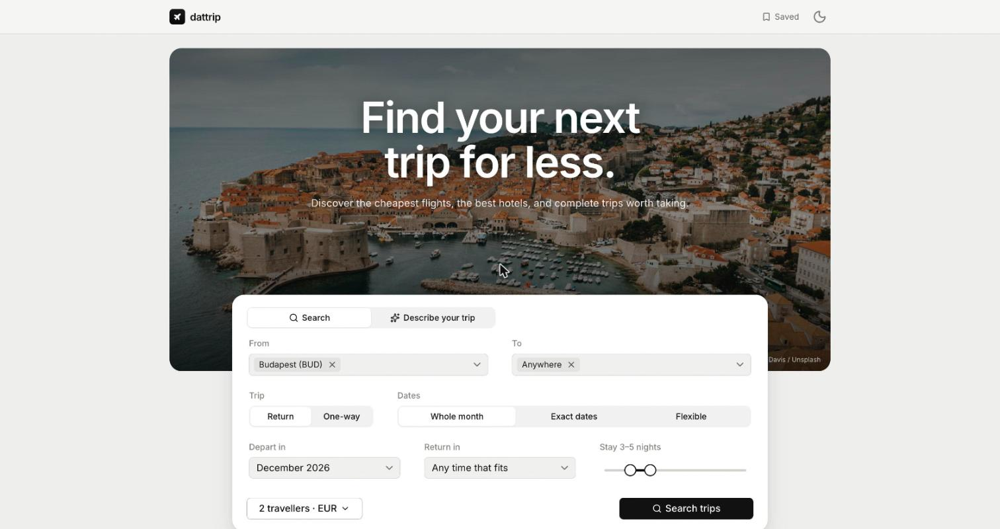

# dattrip

**Find your next trip for less.**

A travel deal finder that pairs real flight fares with well-rated, central hotels and shows you the price of the whole trip before you book.

 

<picture>
  <source media="(prefers-color-scheme: dark)" srcset="./src/assets/screenshots/readme-dark.jpg" />
  
</picture>

## ✨ Key Features

- **🧳 Complete Trips, One Price**: Every result is a full trip: return flights for everyone plus the whole hotel stay and any fees paid at the hotel, added up. You see the total, the price per person and the breakdown.
- **🌍 Anywhere Search**: Leave the destination on *Anywhere* and dattrip ranks 51 curated destinations by the price of the complete trip. You can also pick several cities, or whole countries, to compare in one search.
- **🗓️ Whole Months and Flexible Dates**: Search a whole month with a trip length (say 4–6 nights), exact dates, or exact dates give or take up to three days. One-way flights work too.
- **🛫 Several Departure Airports**: Fly from Budapest *or* Vienna in the same search. Airports and cities autocomplete as you type.
- **🏨 Hotels Worth Staying In**: Only places rated 8.0 or higher and within 3 km of the centre, with hostels left out. Breakfast-inclusive rates rank first, and each pick lists why it was chosen.
- **🏷️ Honest Labels**: *Cheapest*, *Best value* and *Most convenient* are worked out from the trips that were actually priced, and only once every destination has answered.
- **🎚️ Filters and Sorting**: Narrow results by total price, flight time, direct flights, hotel rating, distance from the centre, breakfast, free cancellation and nights. Switch to *Flights only* to sort fares by price, duration, stops or overall value.
- **📄 Trip Pages**: Each trip has its own shareable page with both flights, the hotel gallery, room, meals and cancellation terms, other hotels for the same dates, and a price summary.
- **📆 Cheapest Dates Calendar**: A month grid on the trip page shows the flight price for each departure day, with the cheapest third highlighted. Click a day to search those dates.
- **✨ Describe Your Trip**: Type "somewhere warm from Budapest in March, 4–6 nights" and Gemini turns it into search criteria. On results and trip pages you can ask questions about the offers on screen.
- **💾 Saved Trips**: Save a trip to come back to it. Opening it again checks the current price.
- **🔁 Remembers You**: Your departure airports, travellers and currency are prefilled on your next visit, and the homepage shows live return fares from your airport on the destination cards.
- **🔗 Book at the Source**: Separate buttons take you to Aviasales for flights and to the hotel booking site. The price is re-checked first; if it moved, you see the new price before you leave.
- **💱 Eight Currencies**: EUR, HUF, USD, GBP, CHF, PLN, CZK and RON, applied to flights and hotels alike.
- **🌗 Light and Dark**: Both themes, following your system by default, on phone and desktop layouts.
- **🌟 Premium Minimal UI**: Built on [datui](https://datui.vercel.app/docs), with photography first, neutral tones and subtle motion that respects reduced-motion settings.

## 🛠️ Technology Stack

- **Framework**: [Next.js 16 (App Router)](https://nextjs.org/) with server route handlers
- **Runtime & View Library**: [React 19](https://react.dev/)
- **Styling**: [Tailwind CSS v4](https://tailwindcss.com/) with [datui](https://datui.vercel.app/docs) components
- **Flight Prices**: [Travelpayouts](https://www.travelpayouts.com/) Aviasales Data API
- **Hotel Prices**: [LiteAPI](https://www.liteapi.travel/) (Nuitée)
- **AI**: [Gemini](https://ai.google.dev/) through the official `@google/genai` SDK
- **Validation**: [Zod](https://zod.dev/) for search parameters, environment variables and every provider response
- **Photography**: [Unsplash](https://unsplash.com/), credited at `/credits`
- **Type Safety**: [TypeScript](https://www.typescriptlang.org/) (strict)
- **Icons**: [Lucide React](https://lucide.dev/)
- **Testing**: [Vitest](https://vitest.dev/)
- **Hosting**: [Vercel](https://vercel.com/), with no database

## 📈 How It Thinks

### Searching
- **Step one, flights.** The flight provider is asked for real outbound-and-return date pairs: one request per departure airport and month, not one per day. Pairs outside your dates or trip length are dropped, and the cheapest destinations come back first.
- **Step two, hotels.** Each destination is then priced on its own: hotels for its three cheapest date pairs, combined with the flights. Cards fill in as each destination answers, and one failing never blocks the rest.
- **The cheapest outbound does not decide.** A dearer flight on dates with a cheaper hotel can win, so the comparison is always between complete totals.

### Hotels
- Rating and distance limits come first. Distance is measured from the city centre to the hotel's coordinates.
- A hotel with a breakfast-inclusive rate is shown at *that* rate, never at its cheaper room-only price.
- Among breakfast hotels the lower total wins; when totals are within 3%, the one with more reviews does.
- The single cheapest eligible stay is always kept in the running, breakfast or not, so *Cheapest* really is the cheapest.

### Prices
- **Flight prices are recent fares found by other travellers**, priced for one adult. For more travellers the total is that fare times the party and is labelled as an estimate. The booking site is the final word.
- **Hotel prices are live** for your dates, guests and rooms. Fees the hotel collects on arrival are added to the trip total and listed separately.
- **Nothing is filled in.** The flight source has no arrival times, layover airports or baggage rules, so dattrip does not show them.
- Results are cached briefly (flights for an hour, hotel prices for 15 minutes) and never shown past their expiry.

### AI
- Gemini only fills in the search form or summarises offers already on screen. Prices, ratings and availability always come from the providers.
- Destinations it suggests are limited to dattrip's own catalogue, and its output is validated before use.
- If the AI is unavailable, searching works exactly the same without it.

## ⚖️ Privacy & Security

### Your Data
- There's no sign-up and no login.
- Saved trips, your theme and your remembered search details live only in your browser. Clearing site data removes them.
- A search sends its criteria (airports, dates, number of travellers) to the flight and hotel providers to get prices. Text you type into the AI box is sent to Google's Gemini API.

 

 **dattrip compares; you book elsewhere.** It doesn't sell flights or rooms, take payments or hold reservations. Prices can change between search and checkout, so check the details on the booking site before you pay.

 

**Made with love for love. 🤍**  
*Find your next trip for less.*
